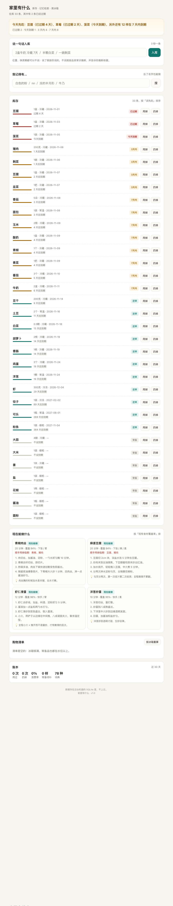
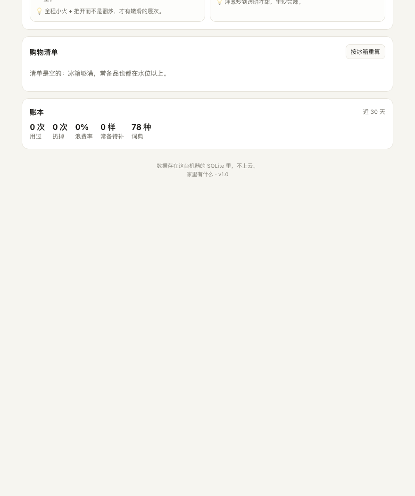
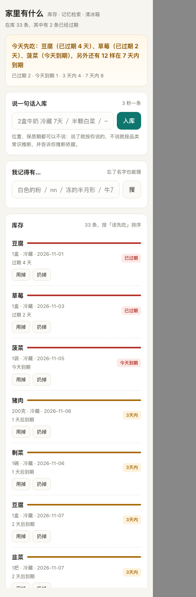

# JingXueQing · C9 验收记录（W1）

> 下面 13 段全部是可核对的证据，不是手写示例：①–⑫ 是**本次真实终端输出**，⑬ 是**真实渲染的界面截图**。
> 复现方式：`cd homepantry && export PANTRY_DB=/tmp/x.db`，逐段跑对应命令。
> 环境：macOS 14.5 / Python 3.13.12 / 零第三方依赖 / 2026-11-04（⑬ 于 11-05 补）

## ① 54 个测试：改一行就知道坏没坏

```bash
python3 -m unittest discover -s tests -t .
```

```text
......................................................
----------------------------------------------------------------------
Ran 54 tests in 0.810s

OK
```

**说明**：0.8 秒跑完。9 个已修 bug 全部有对应回归用例。

## ② 播种：用自然语言原句灌 33 条（播种本身就是一次端到端自检）

```bash
python3 -m pantry.cli seed
```

```text
已灌入 33 条演示数据 → /tmp/pantry_accept.db
```

**说明**：`seed.py` 里的 33 行全部是口语原句，没有一条结构化记录。

## ③ 一句话简报：今天该先吃哪三样

```bash
python3 -m pantry.cli brief -v
```

```text
今天先吃：豆腐（已过期 3 天）、草莓（已过期 1 天）、菠菜（1 天后），另外还有 12 样在 7 天内到期

  豆腐      1盒      [已过期 -3d]
  草莓      1盒      [已过期 -1d]
  菠菜      1袋      [3 天内 +1d]
  猪肉      200克    [3 天内 +2d]
  剩菜      1碗      [3 天内 +2d]
  豆腐      1盒      [7 天内 +3d]
  韭菜      1把      [7 天内 +3d]
  香菇      5朵      [7 天内 +4d]
  面包      1袋      [7 天内 +4d]
  玉米      2根      [7 天内 +5d]
  酸奶      1盒      [7 天内 +5d]
  青椒      1个      [7 天内 +5d]
```

**说明**：刻意只给一句话 + 12 条以内的细节。行业里被静音最多的就是逐条推送。

## ④ 库存：按「该先吃」排序，而不是按录入时间

```bash
python3 -m pantry.cli ls
```

```text
id  食材   数量    位置  到期          状态        
--  ---  ----  --  ----------  ----------
97  豆腐   1盒    冷藏  2026-11-01  [已过期 -3d] 
98  草莓   1盒    冷藏  2026-11-03  [已过期 -1d] 
99  菠菜   1袋    冷藏  2026-11-05  [3 天内 +1d]
80  猪肉   200克  冷藏  2026-11-06  [3 天内 +2d]
96  剩菜   1碗    冷藏  2026-11-06  [3 天内 +2d]
82  豆腐   1盒    冷藏  2026-11-07  [7 天内 +3d]
77  韭菜   1把    冷藏  2026-11-07  [7 天内 +3d]
78  香菇   5朵    冷藏  2026-11-08  [7 天内 +4d]
86  面包   1袋    常温  2026-11-08  [7 天内 +4d]
79  玉米   2根    冷藏  2026-11-09  [7 天内 +5d]
68  酸奶   1盒    冷藏  2026-11-09  [7 天内 +5d]
76  青椒   1个    冷藏  2026-11-09  [7 天内 +5d]
71  青菜   1把    冷藏  2026-11-09  [7 天内 +5d]
72  番茄   3个    冷藏  2026-11-10  [7 天内 +6d]
67  牛奶   2盒    冷藏  2026-11-11  [7 天内 +7d]
83  豆干   200克  冷藏  2026-11-14  [还早 +10d] 
73  土豆   2个    常温  2026-11-16  [还早 +12d] 
70  白菜   0.5颗  冷藏  2026-11-18  [还早 +14d] 
74  胡萝卜  2根    冷藏  2026-11-19  [还早 +15d] 
84  香肠   1根    冷藏  2026-11-19  [还早 +15d] 
69  鸡蛋   3个    冷藏  2026-11-24  [还早 +20d] 
75  洋葱   1颗    常温  2026-11-24  [还早 +20d] 
81  虾    300克  冷冻  2026-12-04  [还早 +30d] 
85  饺子   1袋    冷冻  2027-02-02  [还早 +90d] 
93  可乐   1瓶    常温  2027-08-01  [还早 +270d]
92  粉条   1袋    橱柜  2027-11-04  [还早 +365d]
94  大蒜   4瓣    冷藏  -           [常备]      
88  大米   1袋    橱柜  -           [常备]      
95  姜    1块    冷藏  -           [常备]      
90  盐    1袋    橱柜  -           [常备]      
91  花椒   1两    橱柜  -           [常备]      
89  酱油   1瓶    橱柜  -           [常备]      
87  面粉   1袋    橱柜  -           [常备]      

共 33 条
```

**说明**：过期 → 今天 → 3 天内 → 7 天内 → 还早 → 常备，这个顺序就是动作顺序。

## ⑤ 忘了名字的五种查法

```bash
python3 -m pantry.cli find 白色的粉 / nn / niunai / 牛乃 / 冻的半月形
```

```text
搜「白色的粉」→ 2 条

   74.0  面粉 1袋 @橱柜  常备
         为什么：特征标签「白色」；名称包含
   60.0  盐 1袋 @橱柜  常备
         为什么：特征标签「白色」；特征标签「粉末」

搜「nn」→ 1 条

   87.0  牛奶 2盒 @冷藏  7 天内
         为什么：拼音首字母 NN → 牛奶；紧迫度加分 +2

搜「niunai」→ 1 条

   92.0  牛奶 2盒 @冷藏  7 天内
         为什么：全拼 niunai → niunai；紧迫度加分 +2

搜「牛乃」→ 1 条

   72.0  牛奶 2盒 @冷藏  7 天内
         为什么：疑似错别字（编辑距离 1）；紧迫度加分 +2

搜「冻的半月形」→ 1 条

   60.0  饺子 1袋 @冷冻  还早
         为什么：特征标签「冷冻食品」；特征标签「半月形」
```

**说明**：每条结果都带「为什么匹配」，因为我需要判断它对不对，而不是相信它的分数。

## ⑥ 现在能做什么：覆盖率排序 + 会用到哪些临期食材

```bash
python3 -m pantry.cli cook --top 5
```

```text
今天先吃：豆腐（已过期 3 天）、草莓（已过期 1 天）、菠菜（1 天后），另外还有 12 样在 7 天内到期

青椒肉丝  20min  可以做  覆盖 84%  (100分)
   · 会用到临期：青椒、猪肉
麻婆豆腐  20min  可以做  覆盖 84%  (100分)
   · 会用到临期：豆腐、猪肉
虾仁滑蛋  12min  可以做  覆盖 96%  (96分)
洋葱炒蛋  10min  可以做  覆盖 95%  (95分)
清炒土豆丝  15min  可以做  覆盖 94%  (94分)
```

**说明**：只推「能做」和「差一两样」的，不推「理论上可行」的。

## ⑦ 购物清单：只由两件事生成

```bash
python3 -m pantry.cli shop --sync
```

```text
已同步 1 项到购物清单

  [ ] 葱       1根   做菜缺料  ｜番茄炒蛋、香肠炒饭、紫菜蛋花汤
```

**说明**：缺料（有明确用途）+ 常备跌破水位。不加「手动随意加」以外的花活，因为清单的价值是可信。

## ⑧ 入库：解析依据全部打出来

```bash
python3 -m pantry.cli add "两盒酸奶 冷藏 到11月18日"
```

```text
+ 酸奶 2盒 @ 冷藏  到期 2026-11-18  (置信度 100%)
    · 词典命中：酸奶→酸奶
    · 位置：继承行级「冷藏」
    · 数量：2盒
    · 日期：11/18
```

**说明**：置信度、位置来源、数量来源、日期来源逐条可见。

## ⑨ 用掉 / 扔掉：都进事件流，用来算浪费率

```bash
python3 -m pantry.cli eat <id> --all   /   trash <id>
```

```text
已记一笔浪费：草莓 1（到期日差 -1 天）
{'ok': True, 'name': '牛奶', 'used': 2.0, 'left': 0.0}
```

**说明**：`waste` 会记下「差几天过期」，这是后面算「因为忘了 vs 因为买多了」的原料。

## ⑩ 账本：用了多少 / 扔了多少 / 浪费率

```bash
python3 -m pantry.cli stats
```

```text
在库 32 条 | 已过期 1 | 7 天内到期 12 | 常备待补 0
位置分布：冷藏20  冷冻2  常温4  橱柜6
近 30 天：用过 1 次，扔掉 1 次，浪费率 50%（1 份）
词典规模 78 种
```

**说明**：现在就显示 50% 是因为演示里刚扔了一条、用了一条。这是诚实的 50%，不是美化过的 0%。

## ⑪ 导出：Markdown 库存表（贴到家庭群用）

```bash
python3 -m pantry.cli export --out /tmp/pantry_export.md && head -20 /tmp/pantry_export.md
```

```text
# 家里有什么 · 库存导出

导出时间：2026-11-04

## 冷藏（20）

| 食材 | 数量 | 到期 | 状态 |
|---|---|---|---|
| 豆腐 | 1盒 | 2026-11-01 | 已过期 |
| 菠菜 | 1袋 | 2026-11-05 | 3 天内 |
| 猪肉 | 200克 | 2026-11-06 | 3 天内 |
| 剩菜 | 1碗 | 2026-11-06 | 3 天内 |
| 豆腐 | 1盒 | 2026-11-07 | 7 天内 |
| 韭菜 | 1把 | 2026-11-07 | 7 天内 |
| 香菇 | 5朵 | 2026-11-08 | 7 天内 |
| 玉米 | 2根 | 2026-11-09 | 7 天内 |
| 酸奶 | 1盒 | 2026-11-09 | 7 天内 |
| 青椒 | 1个 | 2026-11-09 | 7 天内 |
```

**说明**：不是每个人都会打开 Web 界面，但每个人都会看群里的图片/文本。

## ⑫ HTTP 接口：给以后的 Agent 调用留的口子

```bash
curl 'http://127.0.0.1:8765/api/state' | python3 -m json.tool | head -20
```

```text
{
  "today": "2026-11-04",
  "items": "<32 条>",
  "brief": {
    "text": "今天先吃：豆腐（已过期 3 天）、菠菜（1 天后）、猪肉（2 天后），另外还有 10 样在 7 天内到期",
    "show": [
      "豆腐（已过期 3 天）",
      "菠菜（1 天后）",
      "猪肉（2 天后）"
    ],
    "total": 13
  },
  "counts": {
    "expired": 1,
    "today": 0,
    "urgent": 3,
    "soon": 9
  },
  "level_alerts": [],
  "stats": {
    "items": 32,
    "by_location": {
      "冷藏": 20,
      "冷冻": 2,
      "常温": 4,
      "橱柜": 6,
      "阳台": 0
    },
    "expired": 1,
    "soon": 12,
    "level_low": 0,
    "waste_30d": 1,
    "waste_qty_30d": 1.0,
    "use_30d": 1,
    "waste_rate_30d": 0.5,
    "catalog_size": 78
  },
  "shopping": [
    {
      "id": 1,
      "name": "葱",
      "qty": 1.0,
      "unit": "根",
      "source": "recipe",
      "why": [
        "番茄炒蛋",
        "香肠炒饭",
        "紫菜蛋花汤"
      ],
      "done": 0,
      "created": "2026-11-04"
    }
  ]
}

--- /api/search?q=白色的粉 ---
{
  "hits": [
    {
      "id": 87,
      "name": "面粉",
      "qty": 1.0,
      "unit": "袋",
      "location": "橱柜",
      "added": "2026-11-04",
      "expires": null,
      "days_left": null,
      "status": "none",
      "status_label": "常备",
      "cat": "主食",
      "note": "",
      "source": "nl",
      "track": "level",
      "score": 74.0,
      "reasons": [
        "特征标签「白色」",
        "名称包含"
      ]
    },
    {
      "id": 90,
      "name": "盐",
      "qty": 1.0,
      "unit": "袋",
      "location": "橱柜",
      "added": "2026-11-04",
      "expires": null,
      "days_left": null,
      "status": "none",
      "status_label": "常备",
      "cat": "调味",
      "note": "",
      "source": "nl",
      "track": "level",
      "score": 60.0,
      "reasons": [
        "特征标签「白色」",
        "特征标签「粉末」"
      ]
    }
  ]
}
```

**说明**：12 个端点（6 读 6 写），纯 JSON。等真有人要接再按需求长，不预先设计。

---

## ⑬ 界面：桌面 880px 与移动端 390px







**取证方式**（这次踩了坑，所以写清楚）：

```bash
"/Applications/Google Chrome.app/Contents/MacOS/Google Chrome" \
  --headless=new --no-sandbox --disable-gpu --disable-dev-shm-usage \
  --user-data-dir=/tmp/cp --hide-scrollbars \
  --window-size=880,4600 --screenshot=/tmp/desk.png \
  --virtual-time-budget=5000 "http://127.0.0.1:8794/"
```

- `--no-sandbox` 是必须的，否则沙箱初始化失败、GPU 进程退出，截图为空。
- **`--window-size=390` 截不出真实的 390px 版面**：无头 Chrome 在 macOS 上最小视口是 500px，它会把 500px 的布局裁成 390px 的图，看起来像"右侧被切掉"。用 `window.innerWidth` 读出来确认过：`innerWidth=500`。
- 真实 390px 的取证方式：用一个 `width:390px` 的 iframe 承载页面（iframe 内媒体查询按 iframe 宽度算），再截外层。上面第 3 张图就是这样拿到的。

