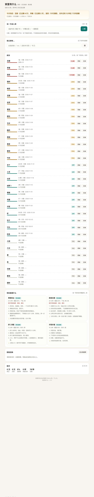
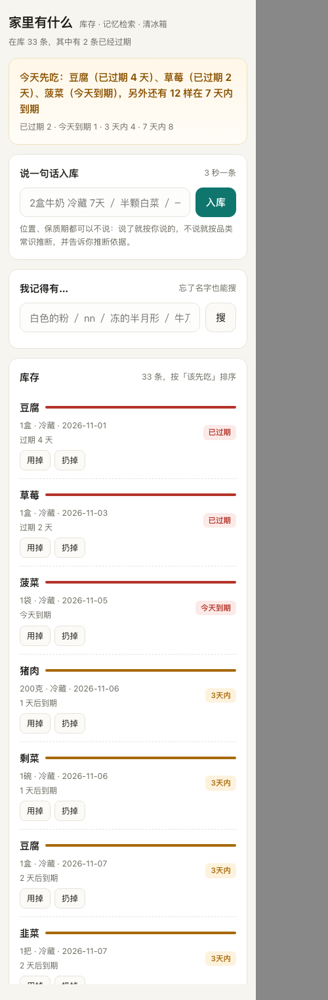
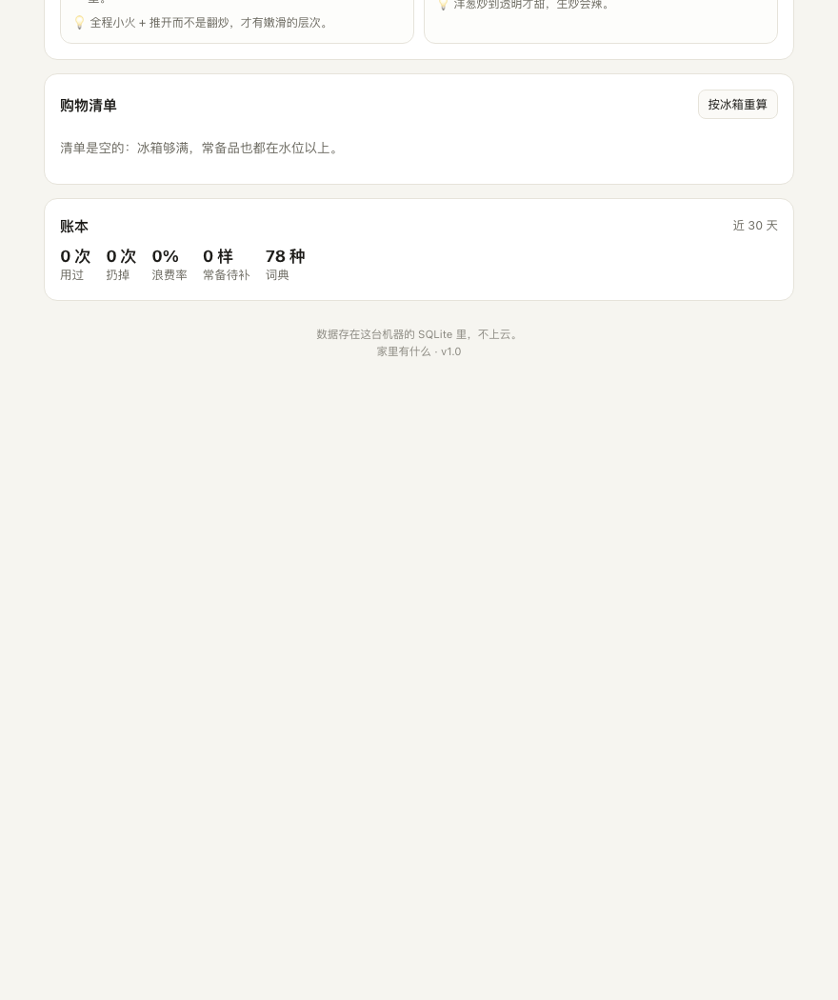

# 家里有什么 · HomePantry

一个给中文家庭用的食材记忆体：**用一句话存进去，用一句模糊的话问出来，快浪费时提前说一句。**

```
你：2盒牛奶 冷藏 7天
你：白色的粉          → 面粉 1袋 @橱柜（特征标签「白色」「粉末」）
它：今天先吃：豆腐（已过期 3 天）、草莓（已过期 1 天）、菠菜（1 天后）
```

零第三方依赖 · 纯本地 SQLite · 不联网 · CLI + 网页双入口。



## 为什么做它

我家冰箱有三层：外层是常吃的，中层是被遗忘的，最里面是上一个季节的。
我装过 6 个食材管理 App，全部在第二周被卸载——**原因永远是同一个：录入太贵**。

所以这个项目只赌一件事：**录入成本决定它能不能活过第二周**。具体表现是三个反直觉的选择：

| 常见做法 | 这里的做法 | 为什么 |
|---|---|---|
| 全量建档，每样都记到期日 | 19 种常备品只记「水位」，不记日期 | 全量建档的系统第二周就变成 fiction |
| 到期逐条推送提醒 | 每天只给**一句话**：今天先吃哪三样 | 逐条推送是被静音最快的方式 |
| 按录入时间排列表 | 按「过期 → 今天 → 3 天 → 7 天」排 | 打开就想知道先动哪个 |
| 猜一个保质期填进去 | 猜的就标「按常识取 N 天」，并给置信度 | 猜错必须当场可见，否则没法纠错 |

## 30 秒跑起来

需要 Python 3.10+，**不需要 pip install 任何东西**。

```bash
cd homepantry
python3 -m pantry.cli seed      # 灌 33 条演示数据（全部是自然语言原句）
python3 -m pantry.cli brief -v  # 今天先吃哪三样
python3 -m pantry.cli serve     # 网页界面 → http://127.0.0.1:8765
```

完整命令、HTTP 接口、目录结构、已知限制见 **[homepantry/README.md](homepantry/README.md)**。

## 它现在能做什么

- **一句话入库**：`2盒牛奶 冷藏 7天` / `半颗白菜` / `一碗剩菜` / `一两花椒 橱柜` / `2盒牛奶和一袋面粉 冷藏`
- **忘了名字也能搜**：特征（`白色的粉`）、拼音（`nn`）、全拼（`niunai`）、错字（`牛乃`）、形状（`冻的半月形`），每条结果都带「为什么匹配」
- **一句话简报**：今天先吃哪几样，以及还有多少在 7 天内到期
- **清冰箱菜谱**：22 道家常菜，按覆盖率排序，标出会用到哪些临期食材、缺什么
- **购物清单**：只由「做菜缺料」和「常备跌破水位」生成，不加花活
- **浪费账本**：扔掉时记录「差几天过期」，让浪费率是个数字而不是感觉

| 手机 390px | 菜谱与账本 |
|---|---|
|  |  |

## 代码质量

```bash
cd homepantry && python3 -m unittest discover -s tests -t .
# Ran 54 tests in 0.7s — OK
```

- 2,434 行（含 388 行测试），12 个模块，78 食材 / 115 别名 / 60 特征标签 / 22 菜谱
- 测试原则：每条对应用户**真会说的一句话**或**真会做的一个动作**，不测实现细节
- 其中 9 条是已修 bug 的回归用例，比如「一两花椒」被连读成 12、「一碗剩菜」的「剩」被当填充词删掉

## 这是谁的什么项目

这是我在 Elite20「C9 自驱项目」里从零定义并推进的项目，W1 已交付 V1。
它同时是一个真实在用的家用工具——不是为交作业造的 demo。

- 项目申请书（问题定义 / 竞品分析 / 自驱动机制 / 8 周里程碑）：[JingXueQing_C9_proposal.md](JingXueQing_C9_proposal.md)
- W1 验收记录（13 段真实终端输出）：[JingXueQing_C9_W1_验收记录.md](JingXueQing_C9_W1_验收记录.md)
- W1 AAR（含动力检查）：[JingXueQing_C9_AAR_W1.md](JingXueQing_C9_AAR_W1.md)
- 推进台账（8 周 + 失败信号）：[JingXueQing_C9_推进台账.md](JingXueQing_C9_推进台账.md)

## 已知限制

没有照片识别（V1 的零依赖约束）；词典只有 78 种食材，覆盖我家常买的，不是全中国家庭；
保质期是常识区间，只用于排序提醒，不能用来判断「还能不能吃」；单机单用户，数据不上云。

删掉 `~/.homepantry/` 就等于彻底删除——没有任何网络请求。

---

W1 · 2026-11
